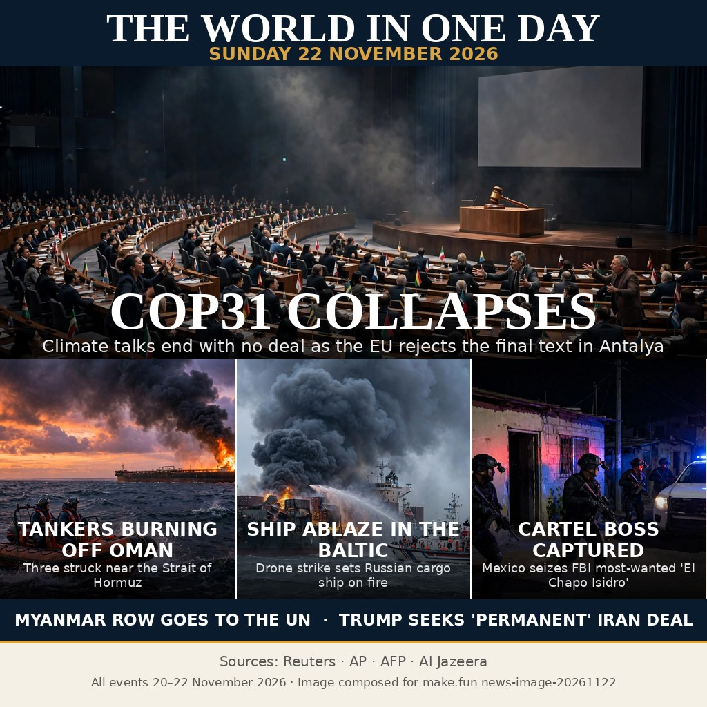

# The World in One Day v2 — 22 November 2026

[](https://make.fun/bounty/news-image-20261122?utm_source=github&utm_medium=readme&utm_campaign=news-image-20261122)
[](https://make.fun/bounty/news-image-20261122/leaderboard?utm_source=github&utm_medium=readme&utm_campaign=news-image-20261122)
[](https://make.fun/bounty/news-image-20261122?utm_source=github&utm_medium=readme&utm_campaign=news-image-20261122)

A make.fun entry for **news-image-20261122**: one image that sums up the
world news of Sunday 22 November 2026 — rebuilt as v2 after the first
version ranked in the thousands.



## What the image shows

A full-colour photo front page. The lead story is the day's biggest
news, and the image says what actually happened on Sunday — not what
was expected the day before:

1. **COP31 COLLAPSES** — After a record 44 hours of overtime in
   Antalya, the EU and other countries rejected the final climate
   text on Sunday. COP31 president Murat Kurum told the closing
   plenary there was no agreement, so the talks ended with no deal:
   the first COP to fail this way since Copenhagen in 2009.
2. **TANKERS BURNING OFF OMAN** — Three tankers were struck near the
   Strait of Hormuz over the weekend; one, the Torkel, burned at
   anchor off Khasab.
3. **SHIP ABLAZE IN THE BALTIC** — A drone strike set the Russian
   cargo ship Sparta II on fire in the Gulf of Finland on Saturday;
   all 16 crew were evacuated and the ship was still burning on
   Sunday.
4. **CARTEL BOSS CAPTURED** — Mexico seized FBI most-wanted fugitive
   Fausto Isidro Meza Flores, 'El Chapo Isidro', in a Sinaloa raid;
   11 people were killed in the fighting.
5. **MYANMAR ROW GOES TO THE UN** — France seeks a Security Council
   meeting after Myanmar rejected the world court's genocide ruling
   on the Rohingya.
6. **TRUMP SEEKS A 'PERMANENT' IRAN DEAL** — The president says any
   agreement must outlast his presidency.

## How it was made

The four photographs are realistic renderings of the reported events,
generated for this entry and composed into the front page with a
script (Python/PIL): masthead, lead photo, three story panels, a
ticker and a footer. Every headline and label is drawn as crisp text
on top of the photos, so nothing is garbled and the page stays
readable even at about 300 pixels across. The photographs depict the
events as reported; they are renderings, not archival news photos.

## How it works

`main.ts` (Node 22, standard library only) copies `entry.png` — a
1024×1024 JPEG under 1 MiB — to `$MAKEFUN_OUTPUT_DIR/entry.png`
(`/output` in the grader), then reads the output back and refuses to
finish unless the bytes match the source exactly and the JPEG start
and end markers are intact. The program is fully deterministic: both
graded runs write byte-identical output.

Run locally:

```sh
mkdir -p out && MAKEFUN_OUTPUT_DIR=out node main.ts
```

## Sources

Stories were checked against the day's reporting (Reuters, AP, AFP,
Al Jazeera, 21–22 November 2026). All events are from 20–22 November
2026; nothing from before 13 November 2026 appears.

## License

MIT — see [LICENSE](LICENSE).
